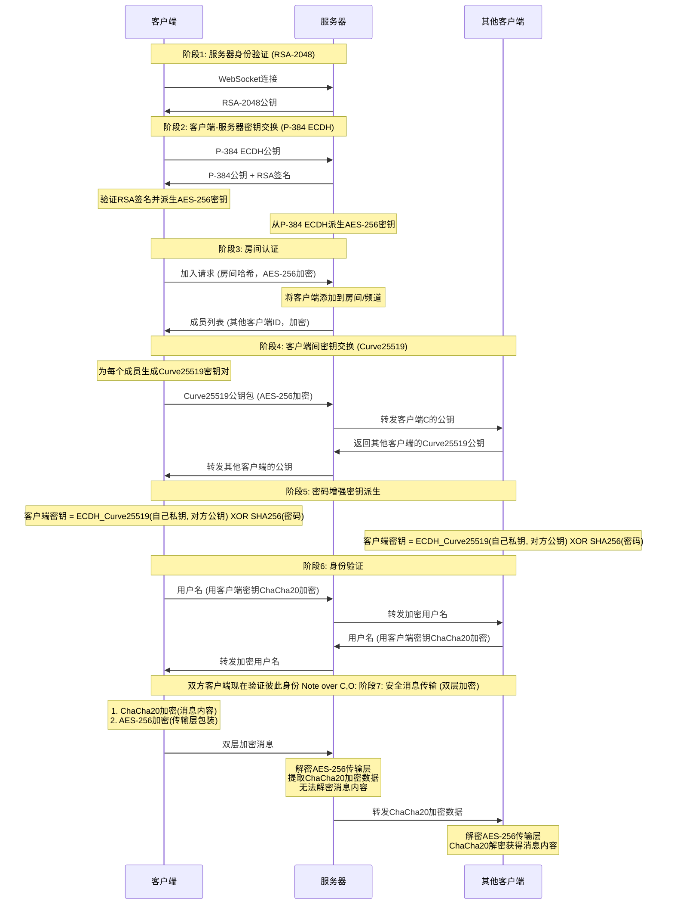

# 加米辽田

🌐 **[English README](README_EN.md)**

## 🚀 部署说明

### 一键部署到 Cloudflare Workers

点击下方按钮即可一键部署到 Cloudflare Workers：

- 构建命令：npm run build
- 部署命令：npm run deploy

### 部署方式功能差异（务必知悉）

| 能力 | Cloudflare Workers（推荐） | Docker 自托管 |
|---|---|---|
| Web Push 离线通知 | ✅ | ❌ 未实现（订阅会被静默忽略） |
| 已读回执 / 断线补拉 | ✅ | ✅（协议层通用） |
| 安全响应头（CSP 等） | ✅ | ✅（R3 修复后已补齐） |
| 房间分片 / 水平扩展 | ✅ 按 DO 分片 | ❌ 单进程 |

> **关于 Worker 名称**：`wrangler.toml` 中 `name = "nodecrypt"` 是有意保留的——更改 Worker 名称会切换 Durable Object 命名空间，导致所有房间的服务器 RSA 密钥重置，已 pin 密钥的现有用户会被锁在房间外。如确需改名，请提前通知所有成员清空浏览器中 `nodecrypt_server_key:*` 前缀的 localStorage 键。

## 📝 项目简介

加米辽田是一个真正的端到端加密聊天系统，实现完全的零知识架构。整个系统设计确保服务器、网络中间人、甚至系统管理员都无法获取任何明文消息内容。所有加密和解密操作都在客户端本地进行，服务器仅作为加密数据的盲中继。

### 系统架构
- **前端**：ES6+ 模块化 JavaScript，无框架依赖
- **后端**：Cloudflare Workers + Durable Objects
- **通信**：WebSocket 实时双向通信
- **构建**：Vite 现代化构建工具

## 🔐 零知识架构设计

### 核心原则
- **服务器盲转**：服务器永远无法解密消息内容，仅负责加密数据中转
- **无数据库存储**：系统不使用任何持久化存储，所有数据仅在内存中临时存在
- **端到端加密**：消息从发送方到接收方全程加密，中间任何环节都无法解密
- **前向安全性**：即使密钥泄露，也无法解密历史消息，因为根本就没有历史消息
- **匿名通信**：用户无需注册真实身份，支持临时匿名聊天
- **多样体验**：和批量发送图片和文件，可选择主题和语言。

### 隐私保护机制

- **实时成员提醒**：房间在线列表完全透明，内任何人加入或离开都会实时通知所有成员
- **服务端零明文日志**：服务器代码不记录任何消息内容（明文或密文），Cloudflare 日志采显式关闭
- **无历史消息**：新加入的用户无法看到任何历史聊天记录
- **私聊加密**：点击用户头像可发起端到端加密的私密对话，房间内其他成员完全无法看到私聊内容

### 房间密码机制

房间密码作为**密钥派生因子**参与端到端加密：`最终共享密钥 = ECDH_共享密钥 XOR SHA256(房间密码)`

- **密码错误隔离**：不同密码的房间无法解密彼此的消息
- **服务器盲区**：服务器永远无法获知房间密码

### 三层安全体系

#### 第一层：RSA-2048 服务器身份验证（TOFU 信任锁定）
- 服务器启动时生成临时 RSA-2048 密钥对，每24小时自动轮换（密钥持久化于 Durable Object 存储，仅用于签名 ECDH 公钥，不接触消息内容）
- 客户端**首次连接时记录（pin）服务器公钥，此后任何变更都会被拒绝并断开**（TOFU：Trust-On-First-Use），防止静默换钥攻击
- 可在部署配置中写死服务器公钥（`rsaPublic`），客户端将强制校验
- 客户端间 Curve25519 密钥交换经**指纹比对**认证：成员列表展示 8 字节通道指纹，双方线下核对一致即可确认交换未被篡改

#### 第二层：ECDH-P384 密钥协商
- 每个客户端生成独立的椭圆曲线密钥对（P-384曲线）
- 通过椭圆曲线 Diffie-Hellman 密钥交换协议建立共享密钥
- 每个客户端与服务器之间拥有独立的加密通道

#### 第三层：认证对称加密（AEAD）
- **服务器通信**：使用 **AES-256-GCM**（认证加密）加密客户端与服务器间的控制消息，密文被篡改会直接解密失败
- **客户端通信**：使用 **ChaCha20-Poly1305**（认证加密）加密客户端之间的实际聊天内容
- 每条消息使用独立的 12 字节随机 Nonce，认证标签防止任何密文篡改
- **房间密码**经 PBKDF2-SHA256（20 万次迭代）拉伸后参与密钥派生，弱密码的暴力破解成本大幅提高

## 🔄 完整加密流程详解

## 🛠️ 技术实现

- **Web Cryptography API**：浏览器原生加密实现，提供硬件加速
- **elliptic.js**：椭圆曲线密码学库，实现 Curve25519 和 P-384
- **aes-js**：纯 JavaScript AES 实现，支持多种模式
- **js-chacha20**：ChaCha20 流加密算法的 JavaScript 实现
- **js-sha256**：SHA-256 哈希算法实现

## 🔬 安全验证

### 加密过程验证
用户可通过浏览器开发者工具观察完整的加密解密过程，验证消息在传输过程中确实处于加密状态。

### 网络流量分析
使用网络抓包工具可以验证所有 WebSocket 传输的数据都是不可读的加密内容。

### 代码安全审计
所有加密相关代码完全开源，使用标准密码学算法，欢迎安全研究者进行独立审计。

## ⚠️ 安全建议

- **使用强房间密码**：房间密码直接影响端到端加密强度，建议使用复杂密码
- **密码保密性**：房间密码一旦泄露，该房间后续通信内容都可能被解密（历史流量因 ECDH 临时密钥仍然安全）
- **核对指纹**：高安全需求下，与对方核对我方成员列表中显示的通道指纹，防止服务器中间人
- **分享链接含凭据**：邀请链接的 `r`/`p` 参数携带房间名与密码（混淆编码，非加密）。接收方打开后链接参数会被立即从地址栏清除（`history.replaceState`），但**转发前的链接本身等于房间钥匙**，请通过可信渠道发送，敏感房间建议单独发送密码
- **无历史消息存储**：服务器无数据库无持久化，历史消息仅存在于各成员浏览器内存中，刷新即失
- **使用最新版本的现代浏览器**：确保密码学API的安全性和性能

## 🤝 安全贡献

欢迎安全研究者报告漏洞和进行安全审计。严重安全问题将在24小时内修复。

## 📄 开源协议

本项目采用 ISC 开源协议。

## ⚠️ 免责声明

本项目仅供学习和技术研究使用，不得用于任何违法犯罪活动。使用者应遵守所在国家和地区的相关法律法规。项目作者不承担因使用本软件而产生的任何法律责任。请在合法合规的前提下使用本项目。

---
## Star History

**加米辽田** - 真正的端到端加密通信 🔐

*"在数字时代，加密是保护隐私的最后一道防线"*

## 📄 License / 许可证

本项目源码以 **[GNU AGPL-3.0](./LICENSE)** 授权 —— 授权边界与保留权利详见 [NOTICE.md](./NOTICE.md)。

- ✅ 可以：自部署、学习审计、修改再分发（须以相同许可证开源）、搭建网络服务（须向你的用户开放修改后的源码 — AGPL 第 13 条）
- ❌ 不可以：闭源 fork、换牌闭源商用、暗示官方背书
- ™️ 「加米辽田 / jiamiliaotian」品牌、Logo 与界面文案**不在**代码授权范围内，fork 须换牌

安全漏洞请勿公开 issue，走 [SECURITY.md](./SECURITY.md) 的私下渠道。

---

> 致谢：本项目基于 [NodeCrypt](https://github.com/shuaiplus/NodeCrypt)（ISC License）架构与代码发展而来。
