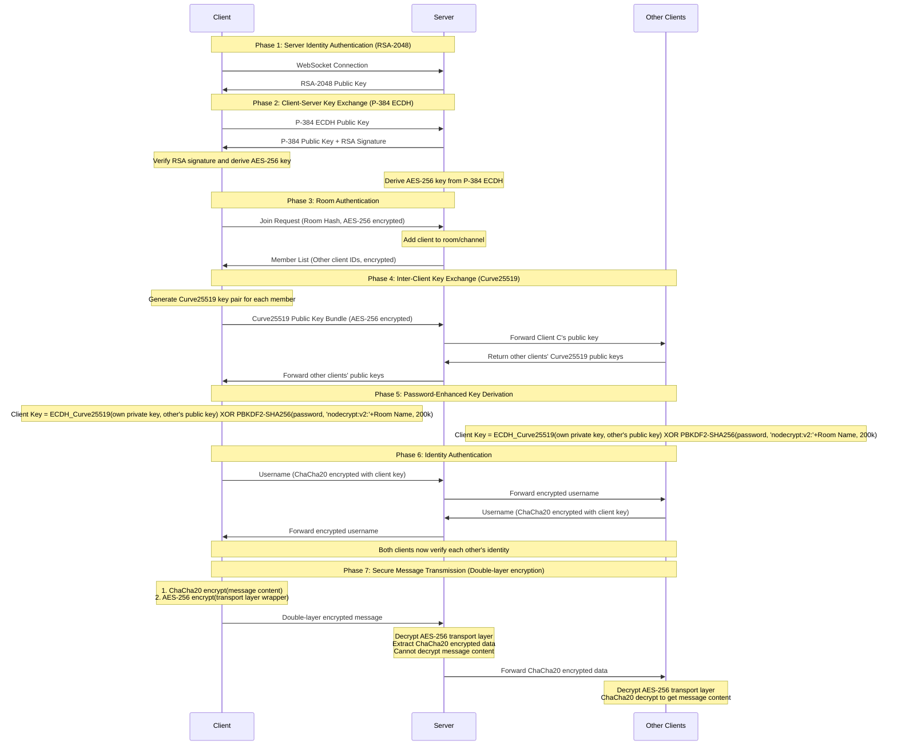

# Jiamiliaotian (加米辽田)

🌐 **[中文版 README](README.md)**

## 🚀 Deployment Instructions

### Method 1: One-Click Deploy to Cloudflare Workers

Click the button below for one-click deployment to Cloudflare Workers:
[](https://deploy.workers.cloudflare.com/?url=https://github.com/btc3149-bit/jiamiliaotian)
> Note: This method creates a new project based on the main repository. Future updates to the main repository will not be automatically synchronized.

### Method 2: Auto-Sync Fork and Deploy (Recommended for Long-term Maintenance)
1. First, fork this project to your own GitHub account.
2. Open the Cloudflare Workers console, select "Import from GitHub," and choose your forked repository for deployment.
> This project has built-in auto-sync workflow. After forking, no action is required. Updates from the main repository will automatically sync to your fork, and Cloudflare will automatically redeploy without manual maintenance.

### Method 3: Docker One-Click Deployment (Recommended for Self-hosting)

```bash
docker build -t jiamiliaotian . && docker run -d --name jiamiliaotian -p 80:80 jiamiliaotian
```

Access http://localhost:80

> **TLS note for Docker deployments**: The Docker image serves plain HTTP only (port 80). In production, always put a TLS-terminating reverse proxy in front of it (e.g. Caddy / Nginx / Cloudflare Tunnel) and let that layer redirect HTTP to HTTPS and send `Strict-Transport-Security: max-age=31536000; includeSubDomains`. Do not expose port 80 directly to the public internet in plaintext.

### Method 4: Local Development Deployment
After cloning the project and installing dependencies, use `npm run dev` to start the development server.
Use `npm run deploy` to deploy to Cloudflare Workers.

## 📝 Project Introduction

Jiamiliaotian is a truly end-to-end encrypted chat system that implements a complete zero-knowledge architecture. The entire system design ensures that servers, network intermediaries, and even system administrators cannot access any plaintext message content. All encryption and decryption operations are performed locally on the client side, with the server serving only as a blind relay for encrypted data.

### System Architecture
- **Frontend**: ES6+ modular JavaScript, no framework dependencies
- **Backend**: Cloudflare Workers + Durable Objects
- **Communication**: Real-time bidirectional WebSocket communication
- **Build**: Vite modern build tool

## 🔐 Zero-Knowledge Architecture Design

### Core Principles
- **Server Blind Relay**: The server can never decrypt message content, only responsible for encrypted data relay
- **No Database Storage**: The system does not use any persistent storage; all data exists only temporarily in memory
- **End-to-End Encryption**: Messages are encrypted from sender to receiver throughout the entire process; no intermediary can decrypt them
- **Forward Secrecy**: Even if keys are compromised, historical messages cannot be decrypted because there are no historical messages at all
- **Anonymous Communication**: Users do not need to register real identities; supports temporary anonymous chat
- **Rich Experience**: Support for sending images and files, with optional themes and languages

### Privacy Protection Mechanisms

- **Real-time Member Notifications**: The room online list is completely transparent; any member joining or leaving will notify all members in real-time
- **No Historical Messages**: Newly joined users cannot see any historical chat records
- **Private Chat Encryption**: Clicking on a user's avatar can initiate end-to-end encrypted private conversations that are completely invisible to other room members
- **No transport-layer authentication for joining (design trade-off, please note)**: Anyone who knows the room name can compute its SHA-256 hash and join the channel — the server will send them the member clientId list, relay transport-layer ciphertext to them, and they can observe metadata such as member join/leave events and message timing. Content security rests entirely on the room password: content-layer keys are derived from Curve25519 ECDH plus the PBKDF2-SHA256-stretched room password, so neither the server nor a lurker without the password can read plaintext. The room password is therefore the only content defense — use a strong one; if an unfamiliar member appears in the member list, treat the room name/password as leaked and change both immediately; for high-security scenarios, verify channel fingerprints out-of-band. There is no room owner / kick mechanism by design, as part of the fully transparent member list model.

### Room Password Mechanism

Room passwords serve as **key derivation factors** in end-to-end encryption: `Final Shared Key = ECDH_Shared_Key XOR PBKDF2-SHA256(Room Password, salt = 'nodecrypt:v2:' + Room Name, 200,000 iterations)` (256-bit output)

- **Password Error Isolation**: Rooms with different passwords cannot decrypt each other's messages
- **Server Blind Spot**: The server can never know the room password

### Three-Layer Security System

#### Layer 1: RSA-2048 Server Identity Authentication
- Server generates temporary RSA-2048 key pairs on startup, automatically rotated every 24 hours
- Client verifies server public key on connection to prevent man-in-the-middle attacks
- Private keys exist only in server memory and are never persistently stored

#### Layer 2: ECDH-P384 Key Agreement
- Each client generates independent elliptic curve key pairs (P-384 curve)
- Establishes shared keys through Elliptic Curve Diffie-Hellman key exchange protocol
- Each client has an independent encrypted channel with the server

#### Layer 3: Hybrid Symmetric Encryption
- **Server Communication**: Uses AES-256-CBC to encrypt control messages between client and server
- **Client Communication**: Uses ChaCha20 to encrypt actual chat content between clients
- Each message uses independent initialization vectors (IV) and nonces

## 🔄 Complete Encryption Process



## 🛠️ Technical Implementation

- **Web Cryptography API**: Native browser PBKDF2 (200k iterations) and ECDH P-384 with hardware acceleration
- **elliptic.js**: Elliptic curve cryptography library implementing Curve25519
- **@stablelib/gcm**: AES-256-GCM (authenticated encryption) for the client-server transport layer
- **@stablelib/chacha20poly1305**: ChaCha20-Poly1305 (authenticated encryption) for the client-to-client content layer
- **js-sha256**: SHA-256 hash algorithm implementation

## 🔬 Security Verification

### Encryption Process Verification
Users can observe the complete encryption and decryption process through browser developer tools to verify that messages are indeed encrypted during transmission.

### Network Traffic Analysis
Network packet capture tools can verify that all WebSocket transmitted data is unreadable encrypted content.

### Code Security Audit
All encryption-related code is completely open source, using standard cryptographic algorithms. Security researchers are welcome to conduct independent audits.

## ⚠️ Security Recommendations

- **Use Strong Room Passwords**: Room passwords directly affect end-to-end encryption strength; complex passwords are recommended
- **No Transport-Layer Join Authentication**: Knowing the room name is enough to join and observe metadata (see Privacy Protection Mechanisms); the room password is the only content defense, and an unfamiliar member in the list means you should change both room name and password
- **Scope of Replay Protection (honest disclosure)**: Ratcheted (KV2) content messages have replay protection. File-transfer volumes, edit/recall actions, call signalling and presence-type actions currently use the legacy session key with no replay protection within a single connection — an attacker positioned at the relay can re-send old ciphertext to re-trigger those actions. Reconnecting rotates the session key, so cross-connection replay does not work. Do not read this as “all messages are replay-protected”.
- **Password Confidentiality**: If a room password is leaked, subsequent communication in that room may be decrypted (past traffic stays safe thanks to ephemeral ECDH keys)
- **Verify Fingerprints**: For high-security needs, compare the per-member channel fingerprint shown in the member list out-of-band to rule out server-side MITM
- **Share Links Carry Credentials**: The `r`/`p` params of an invite link contain the room name and password (obfuscated, not encrypted). Parameters are scrubbed from the address bar on open (history.replaceState), but the link itself equals the room key before it is forwarded — send it over a trusted channel, and for sensitive rooms consider sharing the password separately
- **No History Storage**: The server keeps no database and no message history; past messages live only in members' browser memory and are lost on refresh
- **Use Latest Modern Browsers**: Ensure security and performance of cryptographic APIs

## 🤝 Security Contributions

Security researchers are welcome to report vulnerabilities and conduct security audits. Critical security issues will be fixed within 24 hours.

## 📄 Open Source License

This project uses the AGPL-3.0 open source license; see the License section at the end of this document.

## ⚠️ Disclaimer

This project is for educational and technical research purposes only and must not be used for any illegal or criminal activities. Users should comply with the relevant laws and regulations of their country and region. The project author assumes no legal responsibility for any consequences arising from the use of this software. Please use this project legally and compliantly.

---

**加米辽田 (Jiamiliaotian)** - True End-to-End Encrypted Communication 🔐

*"In the digital age, encryption is the last line of defense for privacy"*

---

> Credits: this project is based on [NodeCrypt](https://github.com/shuaiplus/NodeCrypt) (ISC License).
